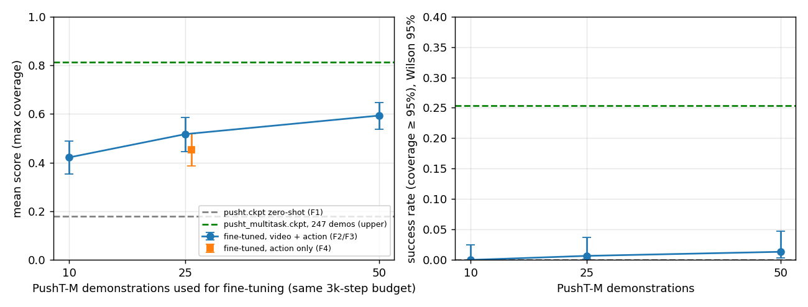
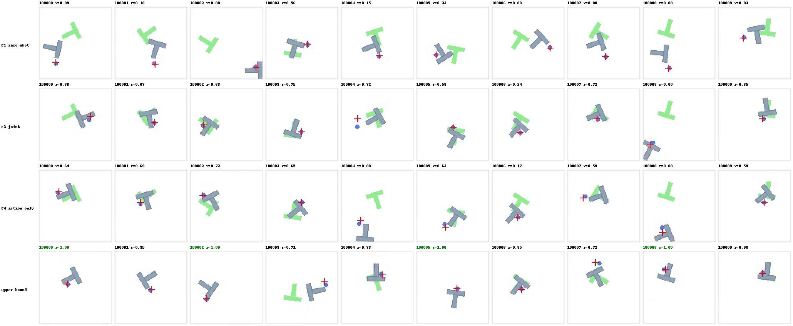
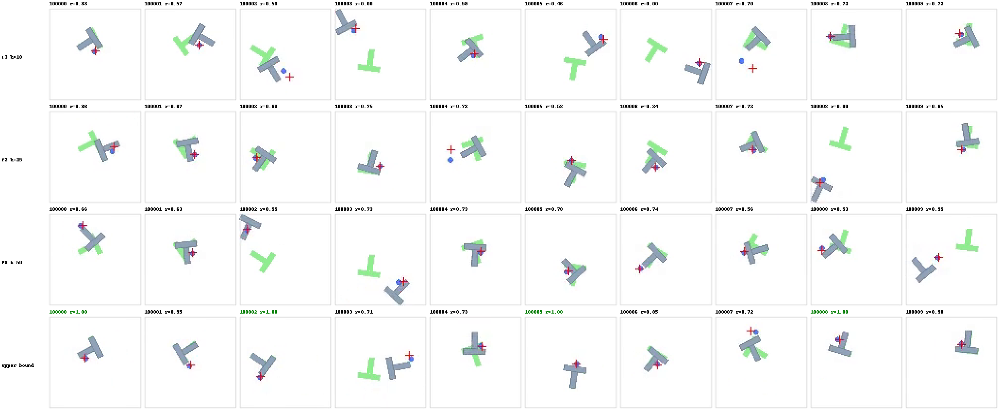
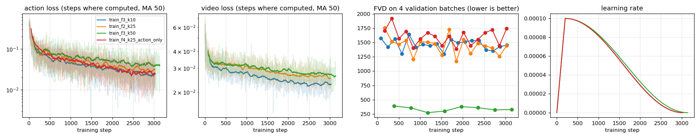

# UVA (Unified Video Action Model): tái lập và fine-tune quy mô nhỏ trên 1 GPU L4

Báo cáo này trả lời các yêu cầu 3–8 của đề, cho Paper 1 (UVA, RSS 2025): dựng codebase và tái lập, fine-tune quy mô
nhỏ, chạy đánh giá và minh hoạ, metric định lượng, phân tích ca thành công / thất bại, một limitation và cách khắc
phục. Phần đọc, tóm tắt và so sánh hai paper (yêu cầu 1–2) nằm ở phần riêng.

Mọi con số dưới đây đều do code trong repository này đo, file gốc ghi ở cuối mỗi mục. Chi tiết từng run:
`docs/EXPERIMENTS.md`; nhật ký lỗi đầy đủ: `docs/DEBUG_LOG.md`.

---

## 0. Tóm tắt

| Câu hỏi | Kết quả | Kết luận |
|---|---|---|
| Checkpoint của tác giả có đạt số trong paper không? | PushT 0.974 (paper 0.98); LIBERO-10 0.865 [0.811, 0.906] (paper 0.90); PushT-M 0.787 (paper 0.88) | **Tái lập được** PushT và LIBERO-10. PushT-M thấp hơn 0.09, phần lớn do **lỗi trong code đánh giá của tác giả** (mục 2.2) |
| Model chỉ biết một đích cố định có học được đích ngẫu nhiên từ ít data không? | Mean score 0.18 → 0.42 / 0.52 / 0.59 với 10 / 25 / 50 demo, mỗi run khoảng 3 giờ trên 1 L4 | **Có, ở mức thô**: model học được "đích ở đâu", lấp được 38–65% khoảng cách tới model train đầy đủ |
| Mục tiêu dự đoán video có giúp policy khi ít data không? | Video + action 0.517, chỉ action 0.454 (chênh +0.063, p ≈ 0.05) | **Có giúp, nhưng bằng chứng yếu** (1 lần train mỗi điều kiện) |
| Đã đủ chính xác để hoàn thành nhiệm vụ chưa? | Success rate 0–1% ở mọi mức data, model train đầy đủ đạt 25% | **Chưa**. Đây là limitation chính (mục 7) |

---

## 1. Bối cảnh ngắn: UVA làm gì và được đo như thế nào

**UVA** là một model vừa **dự đoán video tương lai** (world model) vừa **sinh hành động** (policy):

1. Ảnh được nén thành token bằng một VAE đóng băng.
2. Một transformer (MAR) nhìn 4 frame quá khứ.
3. Hai đầu diffusion nhỏ sinh ra frame tương lai và chuỗi 16 action.

Lúc train, mỗi batch bốc ngẫu nhiên 1 trong 5 bài tập: đoán video, đoán video khi biết action, đoán action, đoán action
từ video tương lai, đoán cả hai. Lúc chạy thật, model **chỉ sinh action, bỏ qua video**, nên vẫn đủ nhanh để điều
khiển. Luận điểm của paper là việc học dự đoán video giúp policy tốt hơn.

**Môi trường:**
- **PushT**: robot tròn đẩy khối chữ T vào một chữ T đích **cố định**.
- **PushT-M**: giống PushT nhưng **đích nằm ngẫu nhiên**. Model chỉ biết đích qua ảnh.
- **LIBERO-10**: 10 nhiệm vụ cánh tay robot nhiều bước trong nhà bếp / phòng khách, mô phỏng 3D.

**Thuật ngữ:**
- **Demo**: một lượt chơi do người làm, được ghi lại để làm data train.
- **Episode**: một lượt chơi của model khi đánh giá (PushT tối đa 300 bước, tức 30 giây).

**Metric:**

| Metric | Định nghĩa |
|---|---|
| **Coverage / reward** | Tỉ lệ diện tích khối T trùng với đích (0–1) |
| **Success** | Coverage ≥ 95% |
| **Mean score** | Coverage cao nhất trong episode, lấy trung bình qua các episode. Đây là metric paper thực sự báo cáo cho PushT (mục 2.3) |
| **Success rate LIBERO** | Tỉ lệ episode hoàn thành nhiệm vụ |

Mọi đánh giá PushT dùng **50 đề cố định** (env seed 100000–100049) × **3 policy seed** (42, 0, 1) = 150 episode.
Khoảng tin cậy 95% là Wilson cho tỉ lệ, và bootstrap theo cặp trên 50 đề khi so hai model.

---

## 2. Dựng codebase và tái lập (yêu cầu 3)

### 2.1 Kết quả tái lập

Máy dùng: GCP `g2-standard-4`, 1× NVIDIA L4 (23 GB), 4 vCPU, **16 GB RAM**. Code là fork của repo chính thức, mọi
thay đổi nằm trên branch `hw-small-scale` và được liệt kê trong README.

| Checkpoint | Môi trường | Của chúng tôi | Paper | Kết luận |
|---|---|---|---|---|
| `pusht.ckpt` | PushT, 150 episode | mean score **0.974 ± 0.016**, success 0.733 | 0.98 | Tái lập được |
| `libero10.ckpt` | LIBERO-10, 10 task × 20 episode | success **0.865** [0.811, 0.906] | 0.90 | Tái lập được (0.90 nằm trong khoảng tin cậy) |
| `pusht_multitask.ckpt` | PushT-M, protocol gốc | mean score **0.787 ± 0.008** | 0.88 | Thấp hơn 0.09, giải thích ở mục 2.2 |
| `pusht_multitask.ckpt` | PushT-M, 50 đích khác nhau (đã sửa lỗi) | mean score **0.813 ± 0.030**, success 0.253 | – | Con số dùng làm cận trên ở mục 3 |

Chi phí: mỗi lần đánh giá 50 đề PushT mất khoảng 6 phút, VRAM 9.3 GB. LIBERO-10 mất khoảng 55 phút, VRAM 10.3 GB.
Không bị OOM sau khi sửa các lỗi ở mục 2.2.

File: `results/exp01/summary.json`, `results/exp05/summary.json`, `results/exp01/notes.md`, `results/exp05/notes.md`.

### 2.2 Các vấn đề chính: nếu không sửa thì không chạy được hoặc không tái lập đúng

Chỉ liệt kê những lỗi làm hỏng việc chạy hoặc làm sai kết quả. Các lỗi cài đặt nhỏ nằm trong `docs/DEBUG_LOG.md`.

**(A) Code đánh giá PushT-M cho mọi episode cùng một đích. Đây là lý do chính của chênh lệch 0.88 so với 0.79.**

- **Triệu chứng:** frame đầu của các episode khác nhau có chữ T đích ở **cùng một chỗ**
  (`results/exp01/figures/pushtm_seed42_first_frames.png`).
- **Nguyên nhân** (đã kiểm chứng): đích được bốc từ bộ sinh số ngẫu nhiên **toàn cục** (`pusht_env.py:348`), không
  phải từ seed riêng của từng episode. Các process simulator được `fork` cùng lúc nên có chung trạng thái ngẫu nhiên.
  Kết quả là mọi episode chạy song song đều nhận **cùng một đích**. Với cấu hình mặc định (56 env trong 1 đợt), **cả
  50 episode đánh giá chỉ dùng 1 đích**.
- **Hệ quả:** điểm PushT-M thực chất là điểm trên 1 đích, rất nhiễu. Đo trên 15 nhóm 1-đích, chúng tôi thấy mean score
  dao động **0.68–0.92**, nên đạt 0.88 trên 1 đích là hoàn toàn có thể. Ngoài ra paper chọn checkpoint tốt nhất dựa
  trên chính các lượt đánh giá đó, càng đẩy số lên cao.
- **Cách sửa:** thêm option `--seeded_goal True`, đích được lấy từ seed của từng episode. 50 đề có 50 đích khác nhau,
  không phụ thuộc số env chạy song song. Mặc định vẫn giữ hành vi gốc để so sánh được với paper.

**(B) Cấu hình đánh giá mặc định không chạy được trên máy 16 GB RAM.**

- **PushT:** code mặc định mở **56 process simulator** cùng lúc và chạy policy trên batch 56, vượt quá RAM của máy.
  Sửa bằng `eval_sim.py --n_envs k` để chạy cùng 50 đề theo từng đợt k env. Kết quả không đổi về ý nghĩa.
- **LIBERO:** 4/10 task bị hệ điều hành kill vì hết RAM (exit 137). Process chính giữ cả checkpoint gốc, model
  không-EMA và optimizer (7.3 GB), trong khi chỉ cần bản EMA. Sửa bằng cách giải phóng các phần không dùng ngay sau
  khi load, còn 3.9 GB. Chạy lại cùng cấu hình thì không còn lỗi.

**(C) Đánh giá LIBERO không chạy được với code chính thức.**

- File môi trường của tác giả **thiếu** robosuite, robomimic, LIBERO, pytorch3d và egl_probe.
- Lỗi chặn quan trọng nhất: worker simulator crash với `EGL_BAD_ALLOC`. Nguyên nhân là `import mujoco` đã mở EGL
  display trong process cha, nên process con tạo bằng `fork` không tạo được context đồ hoạ (đã kiểm chứng bằng test
  riêng: `fork` lỗi, `spawn` chạy được). Sửa bằng option `--mp_context spawn`. Kiểm tra hồi quy cho thấy kết quả
  PushT giống hệt trước khi sửa.
- **Lỗi im lặng:** nếu thiếu file data LIBERO, script vẫn chạy xong và ghi `test_mean_score: NaN` mà không báo lỗi.
  Đã thêm assert để báo lỗi rõ ràng.

**(D) Seed bị ghi đè, khiến "chạy lặp nhiều seed" cho kết quả giống hệt nhau.**

Workspace của tác giả seed lại torch/numpy từ `cfg.training.seed` sau khi script đánh giá đã đặt seed. Ba lần chạy
"seed 42 / 0 / 1" vì vậy ra từng con số giống hệt nhau. Nếu không phát hiện, ta sẽ báo độ dao động bằng 0 và đánh giá
thấp sai số thật. Thực tế chỉ riêng độ ngẫu nhiên của policy đã làm success PushT dao động 0.70–0.80 trên cùng 50 đề.

**(E) Fine-tune với cấu hình nhỏ bị crash nếu chỉ chỉnh số epoch.**

- Code lưu "checkpoint tốt nhất" đọc metric `test_mean_score`, metric này chỉ có ở epoch có rollout, nên ở các epoch
  khác bị KeyError. Sửa bằng `checkpoint.topk.k=0`, vẫn lưu `latest.ckpt`.
- Khi không có env train thì đọc `train/mean_score` cũng bị KeyError. Sửa bằng `task.env_runner.n_train=1`.
- Batch 32 như paper (mỗi GPU) **không vừa** 23 GB. Dùng batch 16 thì chiếm 21.6 GB.

**(F) Hai lỗi phương pháp khi làm thí nghiệm fine-tune.**

- **Tập demo không lồng nhau:** cách chọn k demo của code gốc cho tập 10 demo **không trùng demo nào** với tập 25
  demo. Đường cong theo lượng data khi đó sẽ lẫn "nhiều data hơn" với "demo khác". Sửa bằng option `train_episodes`
  với các tập lồng nhau 10 ⊂ 25 ⊂ 50.
- **FVD trong log training không so sánh được giữa các run:** code chỉ tính FVD trên **16 clip** lấy từ episode
  validation đầu tiên. Run 50 demo vô tình train trên episode 0 và 1, nên FVD của nó được đo trên episode 2 và thấp
  hơn 4 lần (khoảng 350 so với khoảng 1500), dù model không sinh video tốt hơn. Vì vậy FVD trong log **không được
  dùng để kết luận**.

### 2.3 Lưu ý khi so sánh với paper

Paper gọi con số PushT là "success rate", nhưng code ghi `test/mean_score`, tức coverage cao nhất trung bình. Baseline
DP-C (0.91) trong cùng cột cũng là số coverage của Diffusion Policy. Vì vậy con số so được với paper là **mean score
0.974**. Success theo ngưỡng 95% coverage chỉ là 0.733. Hai cách gọi chênh nhau rất xa.

---

## 3. Fine-tune quy mô nhỏ (yêu cầu 4)

### 3.1 Câu hỏi và thiết lập

**Câu hỏi:** model `pusht.ckpt` chỉ từng thấy **một đích cố định**. Với **ít demo** và **1 GPU**, nó có học được
PushT-M (đích ngẫu nhiên) không? Mục tiêu dự đoán video có giúp trong chế độ ít data đó không?

| Thiết lập | Giá trị |
|---|---|
| Khởi tạo | trọng số EMA của `pusht.ckpt`. VAE đóng băng, normalizer tính lại trên PushT-M |
| Data | 10 / 25 / 50 trong 247 demo PushT-M của tác giả, các tập lồng nhau. 222 demo còn lại làm validation |
| Ngân sách | **khoảng 3000 step batch 16 cho mọi run** (ít data thì nhiều epoch hơn), mỗi run khoảng 2 giờ 50 phút trên L4 |
| Optimizer | AdamW lr 1e-4, warmup 200 step, cosine về 0, EMA, fp16 |
| Đánh giá | checkpoint cuối, protocol PushT-M có `--seeded_goal`, 50 đề × 3 policy seed, cùng bộ đề cho mọi model |
| Cận dưới / cận trên | `pusht.ckpt` chưa fine-tune (F1) / `pusht_multitask.ckpt` train trên 247 demo với compute đầy đủ |

Bốn thí nghiệm:
- **F1:** cận dưới, không fine-tune.
- **F2:** 25 demo, train video + action.
- **F3:** 10 và 50 demo, cùng số step với F2.
- **F4:** 25 demo, **chỉ action** (`selected_training_mode=policy_model`). Mọi thứ khác giống F2, cùng tốc độ
  3.13 s/step, tức cùng compute.

### 3.2 Kết quả

| Run | Demo | Mục tiêu | Mean score | Success | % khoảng cách đã lấp |
|---|---|---|---|---|---|
| F1 zero-shot | 0 | – | 0.180 ± 0.009 | 0/150 | 0% |
| F3 | 10 | video + action | 0.421 ± 0.023 | 0/150 | 38% |
| F4 | 25 | **chỉ action** | 0.454 ± 0.042 | 2/150 | 43% |
| F2 | 25 | video + action | 0.517 ± 0.037 | 1/150 | 53% |
| F3 | 50 | video + action | **0.593 ± 0.040** | 2/150 | 65% |
| Cận trên | 247 | train đầy đủ | 0.813 ± 0.030 | 38/150 | 100% |

Phần ± là độ lệch chuẩn qua 3 policy seed. Cột cuối được tính bằng (run − F1) / (cận trên − F1).



So sánh theo cặp trên 50 đề (bootstrap 95%):

| So sánh | Chênh mean score | Khoảng tin cậy 95% |
|---|---|---|
| 25 demo − 10 demo | +0.096 | [0.027, 0.164] |
| 50 demo − 25 demo | +0.076 | [0.005, 0.147] |
| Video + action − chỉ action (25 demo) | +0.063 | [0.003, 0.124], kiểm định hoán vị p = 0.047 |
| Chỉ action 25 demo − video + action 10 demo | +0.032 | [−0.043, 0.106], không phân biệt được |

Chi phí mỗi run train: 2 giờ 47 – 2 giờ 53 phút, VRAM đỉnh 21.6 GB, RAM thấp nhất còn 3.5 GB trống, không OOM.
Checkpoint 4.7 GB, sha256 trong `results/exp02/train_*/checkpoints/SHA256SUMS`.

---

## 4. Đánh giá và hình minh hoạ (yêu cầu 5)

**Frame cuối trên 10 đề đầu tiên** (policy seed 42). Hàng từ trên xuống: F1, F2, F4, cận trên. Chữ T xanh lá là đích;
`r` là coverage cao nhất trong episode.



**Frame cuối theo lượng data** (10 / 25 / 50 demo, cận trên):



**Đường cong training:** action loss, video loss, FVD (chỉ để tham khảo, xem 2.2 F) và learning rate của 4 run.



**Tái lập:**
- ca thất bại PushT / PushT-M: `results/exp01/figures/failure_last_frames.png`;
- lỗi cùng đích của PushT-M: `results/exp01/figures/pushtm_seed42_first_frames.png`;
- LIBERO một ca thành công và một ca thất bại: `results/exp05/figures/soup_tomato_last_frames_success_fail.png`.

Video rollout: `results/exp0*/…/seed*/media/*.mp4` và `results/exp01/rollouts/`, tên file đã gắn sẵn kết quả.

---

## 5. Metric định lượng (yêu cầu 6)

- **Chính:** mean score (coverage cao nhất trung bình) và success rate (coverage ≥ 95%) trên 150 episode, kèm khoảng
  tin cậy 95% (Wilson), độ lệch chuẩn qua 3 policy seed, và bootstrap theo cặp trên 50 đề khi so hai model.
- **LIBERO:** success rate trên 200 episode, kèm khoảng tin cậy Wilson.
- **Phụ, tự định nghĩa** (`scripts/goal_distance.py`): khoảng cách (pixel, khung 96×96) từ tâm khối T ở frame cuối
  tới tâm chữ T đích, median trên 30 video. Metric này tách được hai câu hỏi "đẩy về đúng chỗ chưa" và "căn khít
  chưa".

| | F1 | F3 10 demo | F4 | F2 25 demo | F3 50 demo | Cận trên |
|---|---|---|---|---|---|---|
| Khoảng cách tới đích thật (px) | 21.7 | 9.4 | 11.7 | 4.3 | 5.3 | 2.3 |
| Khoảng cách tới **đích cũ** của PushT (px) | **11.3** | 22.7 | 18.9 | 16.3 | 18.3 | 18.4 |

---

## 6. Phân tích thành công và thất bại (yêu cầu 7)

### 6.1 Checkpoint của tác giả

- **PushT, thành công gần như tuyệt đối về vị trí:** các ca "thất bại" đều **suýt đạt**, coverage 92–95%, ngay dưới
  ngưỡng. Chỉ 1/50 đề chưa lần nào thành công. Chính vì vậy success (0.73) và mean score (0.97) chênh nhau rất xa.
- **PushT-M, thất bại điển hình là sai góc xoay:** nhiều episode dừng ở reward khoảng 0.72. Khối T đã nằm đúng vị trí
  đích nhưng **lệch góc**. 28/50 đề chưa lần nào thành công.
- **LIBERO-10, thất bại tập trung ở task phải xếp hai vật cùng loại vào một chỗ:**
  - "soup + tomato sauce vào giỏ": 0.50;
  - "hai ấm moka lên bếp": 0.70.

  Task một vật, hoặc hai bước trên hai vật khác nhau, đạt 0.90–1.00. Trong ca thất bại có video, episode hết 500 bước
  khi tay robot vẫn loay hoay ở chỗ các vật. Đây mới là quan sát trên 1 video, chưa đủ để kết luận chung.

### 6.2 Fine-tune

- **F1 thất bại vì "học thuộc đích":** model chưa fine-tune **bỏ qua chữ T xanh lá trong ảnh**. Nó kéo khối về phía
  vị trí đích cũ của PushT: cách đích cũ 11.3 px, cách đích thật 21.7 px. Kết quả 0/150 thành công.
- **Fine-tune thành công ở việc "đọc đích từ ảnh":** chỉ sau 1 epoch (168 step, khoảng 9 phút), rollout nhanh trên 10 đề đã đạt
  0.465. Sau fine-tune, khối T kết thúc cách đích thật 4–9 px. F2 tốt hơn F1 trên 45/50 đề.
- **Thất bại ở việc "căn khít":** phần lớn episode F2 dừng ở coverage 0.6–0.8. Khối T **đè lên đích nhưng lệch góc
  hoặc lệch một chút**, cùng kiểu lỗi với cận trên nhưng nặng hơn. Success gần như bằng 0 ở mọi mức data.
- **Thất bại nặng: đẩy khối T ra mép hoặc vào góc** (ví dụ đề 100008 của F2, đề 100004 của F4). Một khi khối T đã
  sát tường, model không có chiến lược kéo nó ra.
- **Overfit khi data quá ít:** với cùng 3000 step, run 10 demo có **train loss thấp nhất** (0.025) nhưng **kết quả
  thấp nhất** (0.421). Run 50 demo có train loss cao nhất (0.041) nhưng kết quả tốt nhất. Mỗi demo của run 10 demo
  bị lặp khoảng 37 lần, nên model học thuộc thay vì tổng quát hoá.

---

## 7. Insight chính

1. **Tái lập được UVA trên 1 GPU, nhưng không thể dùng nguyên code đánh giá.** PushT (0.974 so với 0.98) và LIBERO-10
   (0.865 so với 0.90) khớp với paper. Con số PushT-M của paper nhiều khả năng **đo trên 1 đích duy nhất**, do một lỗi
   ngẫu nhiên trong code đánh giá. Đo đúng trên 50 đích cho 0.813, thấp hơn paper 0.07. Khi tái lập một benchmark, cần
   kiểm tra **bộ đề thật sự được sinh ra** chứ không chỉ con số cuối.

2. **"Success rate" và "mean score" kể hai câu chuyện khác nhau.** Cùng một model PushT: success 0.73 nhưng mean score
   0.97. Ở fine-tune: mean score tăng gấp 3 nhưng success gần như bằng 0. Báo cáo chỉ một metric sẽ gây hiểu sai, nên
   phải báo cả hai, kèm sai số.

3. **Fine-tune ít data dạy được "đi đâu" rất nhanh, nhưng không dạy được "làm chính xác".** 25 demo và 3 giờ GPU đưa
   model từ chỗ bỏ qua đích sang đẩy khối T về đúng vùng đích, gần bằng model train đầy đủ (4.3 px so với 2.3 px).
   Nhưng độ chính xác để vượt ngưỡng 95% coverage thì chưa có ở bất kỳ mức data nào đã thử.

4. **Mục tiêu dự đoán video có tác dụng như "thêm data".** Cùng compute và cùng 25 demo, bỏ phần dự đoán video làm
   mean score giảm 0.063. Kết quả khi đó không phân biệt được với giữ video nhưng chỉ có 10 demo. Ngoài ra, model chỉ
   học action đạt **train loss thấp hơn** nhưng **kết quả kém hơn**, gợi ý rằng mục tiêu video đóng vai trò chống
   overfit. Điều này **ủng hộ luận điểm của UVA**, nhưng là bằng chứng yếu (1 lần train, p ≈ 0.05).

5. **Data quan trọng hơn số lần lặp.** Với ngân sách compute cố định, tăng số demo luôn giúp, khoảng +0.1 mean score mỗi
   lần tăng gấp đôi. Lặp lại ít demo nhiều lần chỉ làm giảm train loss mà không cải thiện kết quả.

6. **Độ ngẫu nhiên của policy rất lớn.** Cùng checkpoint và cùng 50 đề, success PushT dao động 0.70–0.80, mean score
   PushT-M có độ lệch chuẩn 0.03–0.04 giữa các seed. Mọi khác biệt nhỏ hơn khoảng 0.05–0.1 cần đánh giá theo cặp trên cùng bộ đề và lặp
   lại nhiều seed mới kết luận được.

---

## 8. Limitation chính và cách khắc phục (yêu cầu 8)

### Limitation: policy fine-tune đưa vật về đúng vùng nhưng không căn khít được

**Bằng chứng:**
- Ở 10, 25 và 50 demo, success chỉ 0–1.3%, trong khi model train đầy đủ đạt 25%.
- Khối T kết thúc cách đích chỉ 4–5 px, nhưng coverage dừng ở 0.6–0.8 vì **sai góc xoay**.
- Chính model của tác giả cũng có kiểu lỗi này (nhiều episode PushT-M dừng ở reward 0.72), chỉ nhẹ hơn.

Nói cách khác, phần "thô" của nhiệm vụ học được với rất ít data, còn phần "tinh" (xoay khối T vào khớp góc) đòi hỏi
nhiều data hơn hẳn.

**Vì sao:**
1. **Ít đích:** 25–50 demo chỉ bao phủ 25–50 cặp (vị trí, góc) trong một không gian đích liên tục. Riêng góc xoay là
   một chiều mà model phải nội suy từ rất ít ví dụ.
2. **Học bắt chước thuần offline:** model chỉ thấy các trạng thái nằm trên quỹ đạo của người làm demo. Khi lệch khỏi
   quỹ đạo đó, ví dụ khối T bị xoay quá tay hoặc sát tường, nó không có ví dụ nào để học cách sửa.
3. **Ngân sách cố định làm ít data bị overfit:** run 10 demo cho thấy rõ điều này. Ngược lại, run 50 demo có thể **chưa
   train đủ** (train loss còn cao nhất, chỉ 8 epoch).

**Cách khắc phục, xếp theo chi phí từ thấp đến cao:**

| # | Cách làm | Vì sao giúp | Cách kiểm chứng với pipeline sẵn có |
|---|---|---|---|
| 1 | **Gắn lại đích sau sự việc (hindsight goal relabeling)**: phát lại từng demo trong simulator, coi **vị trí cuối thực tế của khối T** (hoặc vị trí giữa chừng) là đích, rồi vẽ lại chữ T xanh lá đúng chỗ đó trong ảnh | Biến 1 demo thành nhiều cặp (quỹ đạo, đích) **khớp hoàn hảo**, tăng số đích mà không cần người làm thêm demo. Đúng vào điểm yếu "ít đích" | So run 25 demo + relabel với F2 và với run 50 demo thật, cùng ngân sách step; đo success và khoảng cách góc |
| 2 | **Fine-tune trong vòng lặp với simulator** (DAgger, hoặc RL dùng coverage làm reward) | Model được thấy chính các trạng thái lệch do mình gây ra và học cách sửa. Simulator PushT rẻ, reward liên tục sẵn có | So success trước và sau, chú ý các ca "đè lên đích nhưng lệch góc" |
| 3 | **Chọn số step theo lượng data** (dừng sớm theo rollout validation) thay vì cố định 3000 step | Tránh overfit ở 10 demo, tránh thiếu train ở 50 demo | Đánh giá các checkpoint trung gian (đã có rollout sau epoch 0), vẽ success theo step |
| 4 | **Thêm metric góc xoay** vào đánh giá | Tách rõ lỗi vị trí và lỗi góc, để biết cách nào thực sự sửa được phần "tinh" | Có thể tính từ trạng thái simulator ở mỗi bước |

Cách 1 là bước tiếp theo nên làm nhất. Nó rẻ (chỉ cần simulator và CPU để render lại), nhắm đúng nguyên nhân, và dùng
được ngay pipeline train và đánh giá hiện có.

### Giới hạn của chính nghiên cứu này

- **Mỗi điều kiện chỉ train 1 lần.** Phần ± chỉ phản ánh độ ngẫu nhiên của policy, chưa phản ánh độ ngẫu nhiên giữa
  các lần train. Kết luận F2 so với F4 (p ≈ 0.05) cần thêm 2 seed train mỗi bên, khoảng 12 giờ GPU, mới vững.
- **Ngân sách 3000 step là cố định**, không tối ưu cho từng mức data (xem cách 3).
- **Không có metric video đáng tin:** FVD trong log không so sánh được giữa các run. Muốn đo chất lượng "tưởng tượng"
  của world model thì cần so frame dự đoán với simulator trên cùng bộ clip (Phase 4 trong kế hoạch).

---

## 9. Tái lập các kết quả trong báo cáo

```bash
# trên VM, trong thư mục repo, env `uva`
bash scripts/run_exp01.sh 10                                      # tái lập PushT / PushT-M
TAG=_seeded_goal EXTRA="--seeded_goal True" bash scripts/run_exp01.sh 10 pusht_multitask
bash scripts/run_exp05.sh 20 5 42                                 # LIBERO-10 (venv LIBERO, docs/ENVIRONMENT.md)
bash results/exp02/driver_f1_f2.sh                                # F1, F2
bash results/exp02/driver_f3_f4.sh                                # F4, F3 (k50, k10)
python scripts/aggregate_seeds.py results/exp02                   # bảng kết quả
python scripts/plot_data_scaling.py -o results/exp02/figures/data_scaling.png
```

| Nội dung | File |
|---|---|
| Kết quả tổng hợp | `results/exp01/summary.json`, `results/exp02/summary.json`, `results/exp05/summary.json` |
| Từng run | `results/exp0*/<run>/seed*/metrics.json`, `command.txt` (commit, sha256 checkpoint, lệnh) |
| Training | `results/exp02/train_*/logs.jsonl`, `.hydra/`, `vram.csv`, `ram.csv` |
| Tập demo | `results/exp02/subsets.json` |
| Thay đổi so với code gốc | README, mục "Changes from upstream" |
