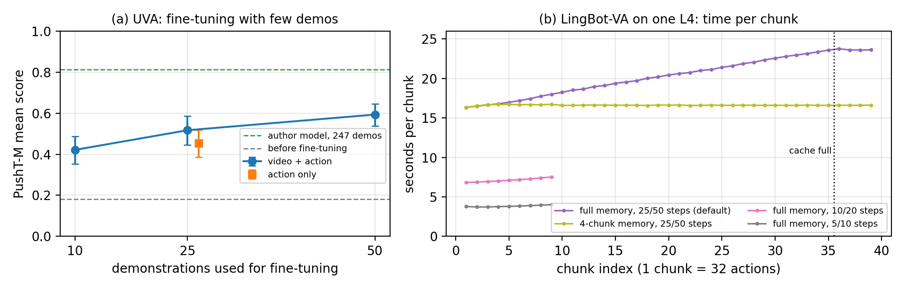
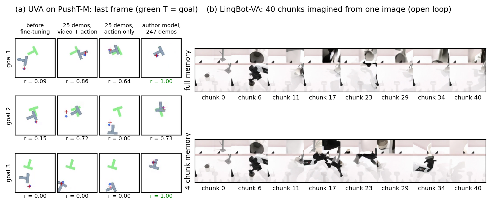

# Part 2 — Đọc và triển khai paper: World Models

*Bản tiếng Việt của [`PART2_en.md`](PART2_en.md) (bản dùng cho technical report). Bảng và hình đánh số tiếp theo Part 1
(Bảng 1, Hình 1). Phân tích đầy đủ hơn về hai paper: [`docs/PAPER_ANALYSIS_vi.md`](../docs/PAPER_ANALYSIS_vi.md). Kết quả
chi tiết: [`REPORT_vi.md`](REPORT_vi.md).*

**Code:** `github.com/vminh16/world-models-uva-lingbot` · **Video demo Part 2:**
[`results/rollouts/part2_demo_small.mp4`](../results/rollouts/part2_demo_small.mp4)

## 2.1 Bài toán

*World model* là mô hình học động lực học của môi trường: từ các quan sát và hành động đã qua, nó dự đoán quan sát tiếp
theo, tức xấp xỉ *p(oₜ₊₁ | o≤ₜ, a≤ₜ)*. Với robot, đây chính là kiến thức mà một policy cần: hành động sẽ làm cảnh thay đổi
ra sao. Trước hai paper này có hai hướng tiếp cận:
- **Policy phản xạ** (Diffusion Policy, OpenVLA, π0) học thẳng ánh xạ từ ảnh sang action. Cách này nhanh, nhưng không học
  động lực học của cảnh, dễ học thuộc quỹ đạo, và chỉ nhìn vài frame gần nhất.
- **Sinh video trước, suy ra action sau** (UniPi) học được động lực học, nhưng chậm vì phải sinh ảnh ở mức pixel, và lỗi
  của video lan sang action.

Cả hai paper cùng trả lời một câu hỏi: **làm sao khai thác dự đoán video để có policy tốt hơn mà vẫn đủ nhanh cho vòng
điều khiển.**

## 2.2 UVA — Unified Video Action Model (RSS 2025)

**Ý tưởng chính.**
- **Biểu diễn ẩn chung.** Ảnh lịch sử, action lịch sử và các frame tương lai (bị che một phần) được mã hoá thành token và
  gộp bởi một transformer (khoảng 0.5B tham số) thành biểu diễn ẩn chung *Z*.
- **Giải mã tách rời.** Hai đầu diffusion nhỏ cùng đọc *Z*: một đầu sinh frame tương lai, một đầu sinh action chunk tiếp
  theo. Khi huấn luyện, model tối ưu *L = L_action + L_video*; khi điều khiển, chỉ đầu action chạy, nên không có video nào
  được sinh ra.
- **Huấn luyện với mask.** Video hoặc action ở đầu vào và đầu ra được che ngẫu nhiên, nên cùng một bộ trọng số đóng được
  nhiều vai trò.

**Đóng góp cho robot learning.**
1. **Tách lợi ích của video khỏi chi phí của video.** Video chỉ có mặt khi huấn luyện, để định hình *Z*. Lúc chạy, policy
   không sinh ảnh, nên trong mô phỏng còn nhanh hơn Diffusion Policy (0.23 s so với 0.36–0.50 s mỗi lần suy luận).
2. **Giám sát bằng video làm giảm overfit.** Khi lịch sử dài ra, UVA giữ được hiệu năng, còn Diffusion Policy suy giảm.
   Bỏ loss video làm PushT-M giảm từ 0.88 xuống 0.46.
3. **Một model cho nhiều vai trò:** policy, sinh video, forward dynamics, inverse dynamics, và policy kết hợp planner. Đây
   là nền tảng để tận dụng dữ liệu không đầy đủ, như video không có nhãn action.

## 2.3 LingBot-VA — Causal World Modeling for Robot Control (RSS 2026)

**Ý tưởng chính.**
- **Một chuỗi nhân quả xen kẽ.** Latent video *z* và action *a* được xếp xen kẽ theo thời gian, *[zₜ, aₜ, zₜ₊₁, aₜ₊₁, …]*,
  dưới mặt nạ attention nhân quả: mỗi token chỉ nhìn các token đứng trước.
- **Dự đoán trước, hành động sau.** Ở mỗi đoạn, model dự đoán latent của các frame kế tiếp, *ẑₜ₊₁ ~ p(· | z≤ₜ, a<ₜ)*, rồi
  suy ra action dẫn tới trạng thái đó (inverse dynamics), *aₜ ~ g(· | ẑₜ₊₁, z≤ₜ, a<ₜ)*. Cả hai được huấn luyện bằng flow
  matching.
- **Mixture-of-Transformers bất đối xứng (5.3B).** Luồng video lớn, khởi tạo từ model video Wan2.2-5B, và luồng action hẹp
  hơn 4 lần có cùng độ sâu và trao đổi thông tin qua attention chung.
- **Trí nhớ dài hạn nhờ KV cache.** Vì attention là nhân quả, key và value của các token cũ không đổi khi có token mới,
  nên được lưu lại và dùng lại. Mỗi bước chỉ tính cho token mới mà vẫn nhìn được toàn bộ lịch sử (trên RoboTwin: tới 36
  đoạn). Khi chạy trên robot, token của **ảnh thật** được ghi vào cache thay cho ảnh tự dự đoán, nên dự đoán luôn được neo
  vào thực tế.
- **Noisy latent augmentation.** Khi huấn luyện, lịch sử video được trộn nhiễu ngẫu nhiên, để luồng action quen đọc latent
  còn nhiễu. Lúc chạy, có thể dừng khử nhiễu video sớm (5 bước).

**Đóng góp cho robot learning.**
1. **World model video dạng nhân quả, chạy được trong vòng kín.** Mỗi bước, model vừa dự đoán tương lai vừa được hiệu
   chỉnh bằng quan sát thật, nên sửa được lỗi trong lúc chạy. Tính nhân quả là quan trọng: trên RoboTwin 2.0 (50 task),
   bản dùng attention hai chiều chỉ đạt 81.5%, so với 92.9%.
2. **Trí nhớ dài cho task quan sát một phần.** Policy theo chunk chỉ dựa vào vài frame gần nhất. LingBot-VA nhớ được những
   gì đã làm, ví dụ đã lau đĩa mấy lần, hay hộp nào đã mở, và vượt π0.5 rõ rệt trên các task này.
3. **Tiền huấn luyện video quy mô lớn chuyển được sang thao tác hai tay với ít dữ liệu.** Với 50 demo mỗi task thật, model
   vượt π0.5 hơn 20% ở các task khó: dài hạn, cần độ chính xác, vật biến dạng.
4. **Đưa model 5B vào vòng điều khiển:** khoảng 0.5 s mỗi bước trên một GPU 48 GB.

## 2.4 So sánh

**Bảng 2.** Hai cách đưa video vào điều khiển robot.

| | UVA | LingBot-VA |
|---|---|---|
| Quan hệ video–action | Biểu diễn ẩn chung, hai đầu giải mã độc lập | Chuỗi nhân quả xen kẽ: dự đoán video, rồi suy ra action bằng inverse dynamics |
| Video lúc điều khiển | **Bỏ qua**: world model ngầm, chỉ dùng khi huấn luyện | **Dự đoán tường minh** ở mỗi bước, có thể dừng khử nhiễu sớm |
| Trí nhớ | Cửa sổ ngắn cố định (PushT: 4 frame trong 1.6 s), mã hoá lại mỗi lần gọi | KV cache, tới 72 latent frame (36 đoạn) |
| Quy mô, dữ liệu | 0.5B, huấn luyện trên dữ liệu của từng benchmark | 5.3B, khởi tạo từ Wan2.2-5B, tiền huấn luyện trên 16k giờ dữ liệu robot |
| Tốc độ theo paper | 0.23 s (mô phỏng, 100 bước khử nhiễu); 95 ms (robot thật, 16 bước) | ≈ 0.5 s mỗi bước (RTX 5880 Ada 48 GB; 5 bước video, 10 bước action) |
| **Đo trên 1× L4 24 GB** | **0.14–0.48 s, 1.9 GB** | **3.8–17 s mỗi đoạn 32 action, 18 GB** (có offload) |

Tốc độ giữa các hàng không so trực tiếp được: GPU khác nhau, tôi offload một phần LingBot-VA sang CPU, paper của LingBot-VA
tính 16 action mỗi bước còn mỗi đoạn của tôi gồm 32 action, và sinh vòng hở không bao gồm việc mã hoá ảnh camera mới.

Khác biệt cốt lõi nằm ở câu hỏi **lúc điều khiển có cần dự đoán video tường minh hay không**, và hai paper đi tới hai câu
trả lời khác nhau. UVA bỏ qua video mà vẫn đạt kết quả cao. Ablation của LingBot-VA lại cho thấy nếu chỉ dùng video làm
tín hiệu huấn luyện (gần với cách làm của UVA), success giảm từ 92.9% xuống 48.3%. Hai kết quả này không so trực tiếp
được, vì mỗi ablation chỉ nói về kiến trúc của chính paper đó. Các thí nghiệm dưới đây làm rõ phần nào câu hỏi trên, cùng
với cái giá về thời gian và bộ nhớ.

## 2.5 Thiết lập, metric và thí nghiệm

Mọi thí nghiệm chạy trên một VM Google Cloud có 1× NVIDIA L4 (24 GB), 4 vCPU và 16 GB RAM, tổng cộng khoảng 17 giờ GPU.
Code là fork của repo chính thức; mọi thay đổi đều là option mới, với giá trị mặc định giữ nguyên hành vi gốc.

**Metric.** *Coverage* là tỉ lệ vùng đích được khối T phủ lên. **Mean score** (PushT, PushT-M) là coverage cao nhất trong
episode chia cho 0.95 (giới hạn ở 1), lấy trung bình qua các episode. **Success** là tỉ lệ episode có coverage cao nhất ≥
95%; với LIBERO là tỉ lệ hoàn thành task. Paper gọi các con số PushT là "success rate", nhưng 0.98 của paper khớp với mean
score của tôi (0.974), không khớp success (0.73), nên tôi so sánh bằng mean score. Với PushT và PushT-M, mỗi cấu hình chạy
trên 50 đề cố định với 3 seed của policy; ± là độ lệch chuẩn qua các seed. Hai model được so theo cặp trên cùng đề, với
khoảng tin cậy 95% tính bằng bootstrap trên 50 đề. LIBERO-10 dùng 20 episode mỗi task, một seed, kèm khoảng tin cậy
Wilson 95%. Fine-tune LingBot-VA (5.3B), hay đánh giá vòng kín trong RoboTwin với 17 s mỗi đoạn, vượt quá một GPU 24 GB,
nên tôi nghiên cứu model này qua sinh vòng hở, chi phí và ablation. Không có simulator, mỗi biến thể được so với bản mặc
định cùng seed (cùng nhiễu ban đầu) qua **độ lệch action**: trung bình |a − a_ref| trên không gian action đã chuẩn hoá. Mốc
tham chiếu là độ lệch khi chỉ đổi seed (0.016).

**Bảng 3.** Các thí nghiệm.

| Mã | Câu hỏi | Cách làm |
|---|---|---|
| EXP-01, 05 | Checkpoint của tác giả có đạt số trong paper không? | PushT, PushT-M, LIBERO-10 |
| EXP-02, 03 | Với ít demo, UVA có học được đích mới không? Loss video có giúp không? | Fine-tune `pusht.ckpt` (chỉ biết một đích cố định) trên 10/25/50 demo PushT-M; một run tắt loss video |
| EXP-07 | Cần bao nhiêu bước khử nhiễu? | UVA với 100, 50, 20, 10, 5 bước |
| EXP-11 | LingBot-VA có chạy được trên 24 GB không? Số bước, trí nhớ và câu lệnh ảnh hưởng thế nào? | Sinh vòng hở 10–40 đoạn từ một ảnh RoboTwin, kèm ablation |

**Một lỗi trong code đánh giá gốc làm lệch kết quả.** Ở PushT-M, đích được bốc từ bộ sinh số ngẫu nhiên toàn cục thay vì
theo seed của đề. Các simulator chạy song song được fork với cùng trạng thái ngẫu nhiên, nên **mọi episode trong một đợt
nhận cùng một đích**. Với cấu hình mặc định (56 simulator một đợt), cả 50 đề chỉ có một đích. Tôi thêm option gắn đích với
seed của từng đề.

## 2.6 Kết quả

**Bảng 4.** Tái lập.

| Model | Môi trường | Đo được | Paper |
|---|---|---|---|
| UVA | PushT | mean score **0.974 ± 0.016** (success 0.73) | 0.98 |
| UVA | LIBERO-10 | success **0.865** [0.811, 0.906] | 0.90 |
| UVA | PushT-M: code gốc (5 đích mỗi lần chạy) / 50 đích khác nhau | 0.787 ± 0.008 / **0.813 ± 0.030** | 0.88 |
| LingBot-VA | RoboTwin, sinh vòng hở | 18 GB VRAM, 17 s mỗi đoạn 32 action | – |

PushT và LIBERO-10 khớp paper trong phạm vi sai số thống kê. Trên 50 đích khác nhau, PushT-M đạt 0.813, thấp hơn 0.88 của
paper 0.07. Hai yếu tố khiến con số của paper khó so sánh. Thứ nhất, với cấu hình mặc định, con số đó nhiều khả năng được
đo trên một đích duy nhất, mà điểm trên một đích dao động từ 0.68 đến 0.92, nên một đích làm phương sai lớn. Thứ hai, paper
báo checkpoint tốt nhất được chọn theo chính điểm đánh giá, điều này kéo con số lên cao. LingBot-VA chạy được trên 24 GB khi
offload bộ mã hoá văn bản và VAE sang CPU; không offload, tôi ước tính bộ nhớ vượt 24 GB, nhưng chưa chạy thử.

**Bảng 5.** Fine-tune UVA trên PushT-M. Mọi run khởi tạo từ `pusht.ckpt` và dùng cùng ngân sách: batch 16, khoảng 3.030 step
(khoảng 3 giờ GPU), AdamW với learning rate 1e-4, 200 step warm-up rồi giảm theo cosine, EMA, fp16; các tập demo lồng nhau
(10 ⊂ 25 ⊂ 50). Hai cột cuối lấy từ frame cuối của 30 episode có video (10 đích đầu × 3 seed, frame 96 px, mỗi thanh của
chữ T dày 5.6 px).

| Demo | Loss huấn luyện | Mean score | Success | Sai số vị trí cuối (median) | Kết thúc đúng tư thế (≤ 2.8 px và ≤ 15°) |
|---|---|---|---|---|---|
| 0 (chưa fine-tune) | – | 0.180 | 0% | 21.3 px | 0/30 |
| 10 | video + action | 0.421 | 0% | 8.8 px | 3/30 |
| 25 | **chỉ action** | 0.454 | 1.3% | 9.4 px | 0/29 |
| 25 | video + action | 0.517 | 0.7% | 4.2 px | 2/30 |
| 50 | video + action | **0.593** | 1.3% | 5.0 px | 4/30 |
| 247 (model của tác giả) | video + action | 0.813 | 25% | 1.4 px | 12/30 |

**Bảng 6.** Số bước khử nhiễu và thời gian suy luận (batch 1, một L4). Điểm UVA dùng một seed của policy; không có độ chênh
theo cặp nào so với 100 bước là có ý nghĩa (mọi khoảng tin cậy đều chứa 0).

| Model | Số bước | Chất lượng | Thời gian |
|---|---|---|---|
| UVA (8 action / lần gọi) | 100 (mặc định) → 20 → 5 | mean score 0.957 → 0.972 → 0.995 | 0.48 → 0.19 → **0.14 s** |
| LingBot-VA (32 action / đoạn) | 25/50 (mặc định) → 10/20 → 5/10 | độ lệch action 0.002 → 0.015 (mốc đổi seed: 0.016) | 17.1 → 7.1 → **3.8 s** |

**Hình 2.** (a) Mean score của UVA trên PushT-M theo số demo dùng để fine-tune; thanh lỗi là khoảng tin cậy 95% trên 50
đích. (b) Thời gian sinh mỗi đoạn của LingBot-VA qua 40 đoạn liên tiếp, với các cấu hình trí nhớ và số bước khử nhiễu
khác nhau.

*Giải thích.* (a) Thêm demo giúp đều đặn: mean score tăng từ 0.18 lên 0.42, 0.52 và 0.59 với 10, 25 và 50 demo. Cả hai
lần tăng đều có ý nghĩa khi so theo cặp trên cùng đích (+0.096 [0.027, 0.164] và +0.076 [0.005, 0.147]), dù các khoảng tin
cậy không theo cặp trên hình chồng lên nhau. Ở 25 demo, tắt loss video (ô vuông cam) làm điểm giảm 0.063 [0.003, 0.124],
xuống ngang mức 10 demo. Điều này xảy ra dù hai run có cùng compute, và run chỉ học action còn được cập nhật action nhiều
hơn (mọi step, so với khoảng 3/5 số step). Kết quả phù hợp với vai trò chống overfit của loss video mà UVA nêu, nhưng bằng
chứng còn yếu: mỗi cấu hình chỉ huấn luyện một lần, và độ chênh xấp xỉ độ dao động giữa các seed. Success gần như bằng 0 ở
mọi mức dữ liệu. (b) Với trí nhớ đầy đủ, thời gian mỗi đoạn tăng tuyến tính từ 16 s lên 24 s, đúng như khi chi phí
attention tỉ lệ với độ dài cache, rồi đi ngang khi cache đầy (đoạn 36). Giới hạn cache ở 4 đoạn giữ thời gian không đổi.
Giảm số bước khử nhiễu tăng tốc nhiều nhất (2.4× ở 10/20 bước, 4.5× ở 5/10 bước), với độ lệch action nằm trong mức dao
động giữa các seed.

## 2.7 Thành công và thất bại

**Hình 3.** (a) Frame cuối của UVA trên ba đích PushT-M (hàng) với bốn model (cột), seed 42 của policy; ba đích được chọn
để minh hoạ ba kết cục điển hình. r là phần thưởng cao nhất đạt được trong episode (r = 1 là thành công), nên có thể khác
với frame cuối. (b) LingBot-VA tưởng tượng 40 đoạn liên tiếp từ một ảnh, không có quan sát thật nào được đưa vào; hàng
trên dùng cache đầy đủ, hàng dưới chỉ giữ 4 đoạn gần nhất.

*Giải thích.*
- **UVA chưa fine-tune bỏ qua đích trong ảnh** và đẩy khối về đích cố định cũ của PushT: vị trí cuối cách đích cũ 11.3 px
  nhưng cách đích của episode 21.7 px (median, 30 episode).
- **Sau fine-tune, model đưa khối tới gần đích nhưng hiếm khi đặt chính xác** (Bảng 5). Với 25–50 demo, sai số vị trí
  median là 4–5 px, gần bằng một bề dày thanh, và chỉ 2–4 trên 30 episode kết thúc trong vòng nửa bề dày thanh và lệch
  dưới 15° so với tư thế đích (model của tác giả: 12/30). Đây là lý do mean score tăng gấp 3 mà success vẫn gần 0.
- **Một cực trị địa phương hay gặp là xoay khoảng 120°.** Chữ T có ba nhánh dài gần bằng nhau, nên một chữ T xoay khoảng
  120° quanh tâm đích vẫn phủ khoảng 2/3 đích (r ≈ 0.7), như ở đích 2 (r = 0.72). Trong các episode kết thúc trong vòng
  nửa bề dày thanh, khoảng một nửa bị xoay theo kiểu này (4/8 ở 25 demo, 4/10 ở 50 demo), và model của tác giả cũng vậy
  (5/17).
- **Thất bại nặng nhất là khi khối bị đẩy sát tường hoặc vào góc** (đích 3; đích 2 với model chỉ học action). Model không
  kéo được khối ra, nhiều khả năng vì không demo nào chứa trạng thái như vậy.
- **Trong lần chạy 40 đoạn, LingBot-VA giữ mạch lạc khoảng 10 đoạn đầu:** tay với tới cốc, nắm cốc, đưa về phía giá. Sau
  đó cảnh trôi dần dù cache đầy đủ (giá và tay robot mờ dần). Khi cache chỉ giữ 4 đoạn, tay kẹp vỡ thành nhiều mảnh từ
  khoảng đoạn 15.
- **Câu lệnh có ảnh hưởng yếu:** đổi câu lệnh thành "…place it on the left side of the table" làm action lệch 0.028, nhưng
  video vẫn đưa cốc lên giá (một lần thử).
- **Trên LIBERO-10,** hai task yếu nhất (0.50 và 0.70, mỗi task 20 episode) đều phải đặt hai vật vào cùng một chỗ (giỏ,
  bếp); mọi task khác đạt ít nhất 0.85.

## 2.8 Thảo luận: đối chiếu tái lập với paper

**Ngầm hay tường minh: giá trị của video phụ thuộc vào bối cảnh.** Trong ablation của chính UVA, bỏ video làm giảm 0.53
trên PushT và 0.42 trên PushT-M nhưng chỉ 0.04 trên LIBERO-10; khi fine-tune từ checkpoint đã học video (thí nghiệm của
tôi), mức giảm là 0.063; trong ablation của LingBot-VA là 45 điểm. Độ dài task không giải thích được các khác biệt này, vì
LIBERO-10 gồm các task dài. Một giả thuyết là loss video có ích nhất khi biểu diễn ẩn chưa học được động lực học của cảnh,
và ít có ích hơn khi đã học được (trường hợp fine-tune của tôi). Giả thuyết này hợp với PushT và PushT-M nhưng không hợp
với LIBERO-10, nơi model chỉ học action (0.86) gần bằng UVA (0.90), có thể vì cả hai đã gần trần. Ablation của LingBot-VA
gắn với kiến trúc của nó, trong đó luồng action nhỏ được thiết kế để dựa vào latent video vừa dự đoán. Về chi phí, ở config
mặc định của LingBot-VA, phần sinh video chiếm khoảng 6 trong 17 s mỗi đoạn. Khoảng cách lớn hơn nhiều giữa hai model ở
Bảng 2 còn do kích thước chênh nhau 10 lần (0.5B và 5.3B), nên không thể quy hết cho việc dự đoán video. Cả hai model đều
dùng video theo một cách cố định, không tự chọn được *lúc nào* đáng để tưởng tượng.

**Số bước khử nhiễu: config mặc định không phải giới hạn của model.** LingBot-VA báo rằng giảm từ 25 xuống 15 bước khử
nhiễu video không làm đổi success, và dùng 5 bước trên robot thật, trong khi repo để mặc định 25/50. Kết quả vòng hở của tôi
phù hợp với claim này: ở 10/20 bước, action gần như trùng bản mặc định. UVA dùng 100 bước trong mô phỏng, nhưng 5 bước
không làm giảm điểm PushT và nhanh hơn 3.5× (một seed, task một đích; chưa kiểm tra trên task khó hơn). Vì vậy, khi so tốc
độ giữa các phương pháp, cần so ở cùng mức chất lượng thay vì ở config mặc định.

**KV cache cho trí nhớ dài nhưng có giá, và tưởng tượng vòng hở trôi nhanh.** Cache loại bỏ việc mã hoá lại lịch sử, nhưng
thời gian mỗi bước vẫn tăng tuyến tính theo độ dài cache. Cắt cache thì mất nhất quán, và ngay cả với cache đầy đủ, lần
chạy vòng hở của tôi cũng trôi sau khoảng 10 đoạn. Success dài hạn mà paper báo nhiều khả năng dựa vào việc token của ảnh
thật liên tục thay thế phần tưởng tượng trong cache; tôi chưa chạy vòng kín nên chưa kiểm chứng được. Trong lần chạy này
(một ảnh, một câu lệnh, một seed), tự bản thân model chưa phải một simulator dài hạn đáng tin.

**Giao thức đánh giá là một phần của kết quả.** Với cấu hình mặc định, lỗi "chung một đích" khiến con số PushT-M nhiều khả
năng chỉ phản ánh một đích, và paper báo checkpoint được chọn theo chính điểm đánh giá. Bảng của UVA ghi "success rate",
nhưng phần mô tả PushT-M nói là "average reward"; trên cùng một model, hai metric này cách xa nhau (PushT: 0.97 và 0.73).
Benchmark nhiều đích cần kiểm tra trực tiếp độ đa dạng của đề, và nên báo cả hai metric.

## 2.9 Limitation chính và hướng khắc phục

**UVA sau fine-tune đưa khối tới gần đích nhưng không đặt được chính xác.** Ở mọi mức 10–50 demo, success chỉ 0–1.3%
(model huấn luyện đầy đủ: 25%). Khối dừng cách đích 4–9 px (median), và chỉ 0–4 trên 30 episode kết thúc trong vòng nửa
bề dày thanh và lệch dưới 15° (Bảng 5); gần đích, xoay 120° là một cực trị địa phương thường gặp của coverage. Ba nguyên
nhân khả dĩ:
1. 25–50 demo chỉ phủ thưa không gian vị trí và góc của đích.
2. Học bắt chước offline không có dữ liệu về cách sửa sai khi đã lệch, ví dụ khi khối sát tường hoặc đã xoay sai.
3. Loss video lấy trung bình đều trên mọi token của frame, nên các chi tiết nhỏ quyết định độ chính xác (đầu robot, mép
   khối) đóng góp rất ít. Chúng cũng trông nhoè trong các frame dự đoán tôi đã xem, nhưng tôi chưa đo điều này.

**Hướng khắc phục, từ rẻ đến đắt.**
1. **Gắn lại đích (hindsight relabeling).** Demo vốn kết thúc đúng tại đích, nên tư thế cuối không cho thêm đích mới. Thay
   vào đó, lấy tư thế của khối tại các thời điểm *giữa* quỹ đạo làm đích cho đoạn quỹ đạo trước đó, rồi vẽ lại đích trong
   ảnh. Mỗi demo trở thành nhiều cặp (quỹ đạo, đích) với góc đích đa dạng hơn, và chỉ cần CPU để render lại.
2. **Fine-tune trong vòng lặp với simulator** (DAgger, hoặc RL), để model học từ chính các trạng thái lệch mà nó gây ra.
   Với RL, reward theo sai số tư thế (vị trí và góc) sẽ tránh được cực trị địa phương 120° mà coverage có.
3. **Đánh trọng số loss theo vùng:** tăng trọng số cho các token chứa robot và vật được thao tác.

**Hướng phát triển: world model thích nghi.** Từ phần thảo luận, một hướng tự nhiên là model chạy như UVA theo mặc định
(bỏ qua video, phản xạ nhanh) và chỉ chuyển sang dự đoán video tường minh như LingBot-VA khi độ bất định cao: trước khi tiếp
xúc, khi thao tác chính xác, hoặc khi dự đoán ở bước trước lệch so với ảnh thật. Ở config mặc định của LingBot-VA, video
chiếm khoảng 1/3 thời gian mỗi đoạn; đó là phần tiết kiệm được ở các bước dễ, với điều kiện luồng action được huấn luyện để
chạy được khi không có video dự đoán.

**Giới hạn của nghiên cứu này.** Mỗi cấu hình fine-tune chỉ được huấn luyện một lần, nên kết luận "loss video có ích" có
khoảng tin cậy sát 0. LingBot-VA chỉ chạy vòng hở, và ablation dùng một seed, nên các nhận định về trí nhớ và câu lệnh mang
tính định tính.
