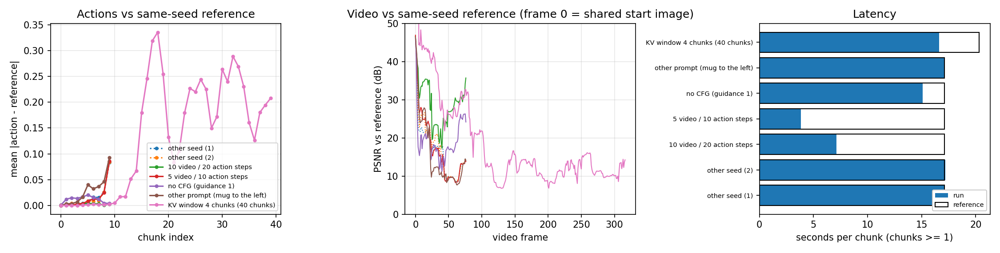
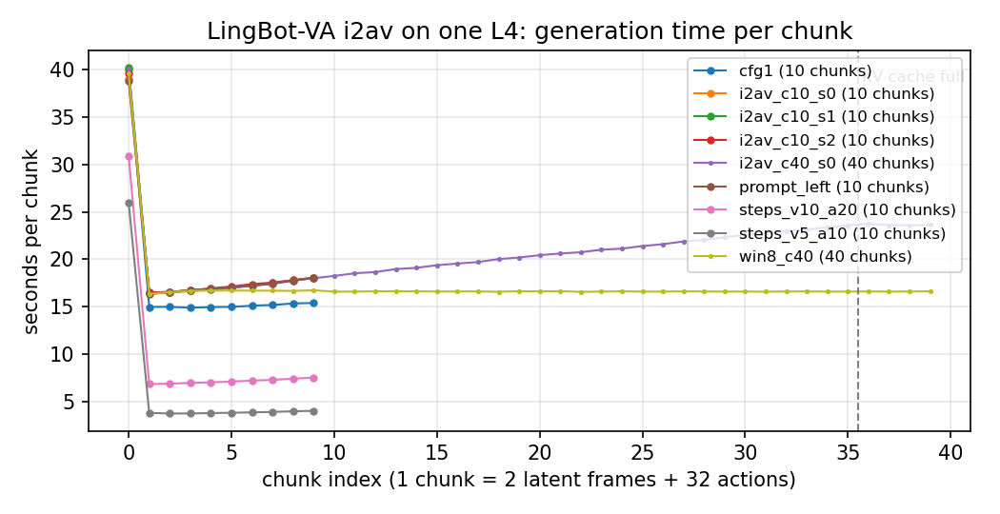

# Part 2: Tái lập và đánh giá hai world model cho robot trên một GPU — UVA và LingBot-VA

Mọi con số trong báo cáo đều do code trong repo này đo. Lệnh chạy lại từng thí nghiệm nằm ở mục 8.

**Video demo Part 2 (2 phút 30 giây):** [`results/rollouts/part2_demo_small.mp4`](../results/rollouts/part2_demo_small.mp4)

---

## Tóm tắt

Báo cáo tái lập hai world model cho robot trên một GPU 24 GB: **UVA** (sinh video và action chung, RSS 2025) và
**LingBot-VA** (world model tự hồi quy nhân quả, RSS 2026). Sau đó báo cáo dùng bốn thí nghiệm để kiểm tra các luận
điểm chính của hai paper.

| Câu hỏi | Kết quả chính |
|---|---|
| Số liệu của paper có tái lập được không? | UVA: PushT 0.974 (paper 0.98), LIBERO-10 0.865 (paper 0.90). PushT-M thấp hơn paper 0.07, và một phần chênh lệch do lỗi trong code đánh giá. LingBot-VA: chạy được inference trên 24 GB, chưa đánh giá vòng kín |
| Mục tiêu video có giúp policy khi ít data không? | Có: +0.063 [0.003, 0.124] so với chỉ học action, cùng 25 demo. Bằng chứng còn yếu |
| Fine-tune với ít demo học được gì? | Đưa khối tới gần đích (sai số median 4–9 px), nhưng hiếm khi đặt đúng cả vị trí lẫn góc (2–4/30 episode); gần đích hay kẹt ở góc xoay khoảng 120° (success gần 0) |
| Chi phí inference có phải giới hạn của model không? | Không. Cả hai model dùng nhiều bước khử nhiễu hơn mức cần: giảm số bước làm UVA nhanh hơn 3.5×, LingBot-VA nhanh hơn 2.4×, chất lượng không giảm |
| Trí nhớ dài của LingBot-VA có giá thế nào? | Thời gian mỗi bước tăng tuyến tính theo lịch sử. Cắt trí nhớ thì video vỡ. Trong một lần chạy, tưởng tượng vòng hở trôi sau khoảng 10 đoạn |

Tài nguyên: 1× NVIDIA L4 (23 GB), 4 vCPU, 16 GB RAM, khoảng 17 giờ GPU.

---

## 1. Hai paper *(phần này người viết tự điền)*

### 1.1 UVA — Unified Video Action Model (RSS 2025)

> *TODO: bài toán, ý tưởng chính, đóng góp.*

### 1.2 LingBot-VA — Causal World Modeling for Robot Control (RSS 2026)

> *TODO: bài toán, ý tưởng chính, đóng góp.*

### 1.3 So sánh hai paper

> *TODO: bảng so sánh (kiến trúc, cách sinh video và action, trí nhớ, tốc độ, kích thước, data, ứng dụng).*

Có thể dùng các số đo ở mục 4.2 và 4.3 cho bảng này: tốc độ, bộ nhớ và hành vi của trí nhớ, đo trên cùng một GPU.

---

## 2. Thiết lập và phương pháp đánh giá

### 2.1 Phạm vi

| | UVA | LingBot-VA |
|---|---|---|
| Checkpoint | `pusht.ckpt`, `pusht_multitask.ckpt`, `libero10.ckpt` của tác giả | `lingbot-va-posttrain-robotwin` |
| Đã làm | Đánh giá trong simulator, fine-tune, đo chi phí inference | Inference "ảnh → video + action" ở chế độ vòng hở, đo chi phí, ablation |
| Không làm | Train lại từ đầu (tác giả dùng 4–8 GPU trong nhiều ngày) | Fine-tune, đánh giá vòng kín trong RoboTwin (vượt quá một GPU 24 GB) |

Mọi thay đổi so với code gốc đều là option thêm vào. Giá trị mặc định của các option giữ nguyên hành vi gốc. Danh
sách đầy đủ nằm trong README.

### 2.2 Metric

**Đánh giá policy trong simulator (UVA).**
- **Coverage** (PushT, PushT-M): tỉ lệ diện tích khối T trùng với vùng đích.
- **Mean score**: coverage cao nhất trong episode, chia cho 0.95 (giới hạn ở 1), rồi lấy trung bình qua các episode.
  Paper gọi con số PushT là "success rate", nhưng 0.98 của paper khớp với mean score (0.974), không khớp success (0.73),
  nên mean score mới là con số so được với paper.
- **Success rate**: tỉ lệ episode có coverage ≥ 95% (với LIBERO là tỉ lệ hoàn thành task). Báo kèm khoảng tin cậy
  Wilson 95%.
- **Sai số vị trí và sai số góc cuối episode** (`scripts/pose_error.py`): khớp template chữ T vào đích và vào khối ở
  frame cuối của 30 video mỗi run (frame 96 px, mỗi thanh chữ T dày 5.6 px). Dùng để tách lỗi vị trí khỏi lỗi góc.
- **So sánh theo cặp**: hai model được chạy trên cùng 50 đề cố định. Độ chênh được tính theo từng đề, rồi lấy khoảng
  tin cậy bằng bootstrap. Cách này loại phần biến thiên do độ khó của từng đề. Mỗi cấu hình chạy 3 policy seed.

**Đánh giá world model ở chế độ vòng hở (LingBot-VA).** Không có simulator, nên không đo được success. Thay vào đó, mỗi
ablation được so với bản gốc **cùng seed** (cùng nhiễu ban đầu):
- **Độ lệch action** (trung bình |Δ| trong không gian action đã chuẩn hoá);
- **PSNR** của video so với bản gốc.

Mốc tham chiếu là độ lệch giữa hai seed khác nhau của bản gốc (action lệch 0.016, PSNR 16–17 dB). Thay đổi nào nhỏ
hơn mốc này thì coi như không phân biệt được với nhiễu lấy mẫu.

**Chi phí.** Thời gian mỗi lần gọi model, đo có đồng bộ CUDA, ở batch 1. VRAM đỉnh.

### 2.3 Danh sách thí nghiệm

Mỗi thí nghiệm có một mã EXP-xx. Các mục sau tham chiếu tới thí nghiệm bằng mã này. Kết quả nằm ở
`results/expxx/` (riêng EXP-03 nằm chung với EXP-02 ở `results/exp02/`).

| Mã | Model | Câu hỏi | Cách làm | Mục |
|---|---|---|---|---|
| EXP-01 | UVA | Tái lập PushT và PushT-M | Checkpoint của tác giả, 50 đề × 3 policy seed | 3.1 |
| EXP-05 | UVA | Tái lập LIBERO-10 | Checkpoint của tác giả, 10 task × 20 episode | 3.1 |
| EXP-02 | UVA | Với ít demo, model có học được đích mới không? | Fine-tune `pusht.ckpt` trên 25 demo PushT-M; so với model chưa fine-tune | 4.1 |
| EXP-03 | UVA | Cần bao nhiêu demo? Mục tiêu video có giúp policy không? (luận điểm chính của UVA) | Như EXP-02 với 10 và 50 demo; một run 25 demo tắt loss video | 4.1 |
| EXP-07 | UVA | Cần bao nhiêu bước khử nhiễu? Inference tốn bao nhiêu? | PushT với 100 / 50 / 20 / 10 / 5 bước | 4.2 |
| EXP-11 | LingBot-VA | Inference có chạy được trên 24 GB không? Số bước khử nhiễu, độ dài trí nhớ, câu lệnh và CFG ảnh hưởng thế nào? | Sinh video + action vòng hở từ một ảnh; mỗi ablation so với bản gốc cùng seed | 3.2, 4.2–4.4 |

### 2.4 Vấn đề trong code gốc ảnh hưởng tới kết quả

| Vấn đề | Ảnh hưởng | Xử lý |
|---|---|---|
| **PushT-M: mọi episode chạy song song nhận cùng một đích** (đích được bốc từ bộ sinh ngẫu nhiên toàn cục, rồi các process được fork với cùng trạng thái) | Mỗi đợt simulator chạy song song chỉ có 1 đích; với cấu hình mặc định (56 simulator một đợt), cả 50 đề chỉ có 1 đích. Điểm phụ thuộc vào việc đích đó dễ hay khó (0.68–0.92) | Gắn đích với seed của từng đề (`--seeded_goal`) |
| **Seed bị ghi đè trong workspace** | Các "seed khác nhau" cho kết quả giống hệt, sai số bị báo bằng 0 | Truyền seed vào cấu hình |
| **Tập demo 10/25/50 lấy ngẫu nhiên, không lồng nhau. FVD chỉ tính trên 16 clip** | Đường cong theo lượng data bị lẫn yếu tố khác. FVD không so sánh được giữa các run | Tập lồng nhau (10 ⊂ 25 ⊂ 50). Không dùng FVD để kết luận |

Ngoài ra còn một số lỗi chỉ làm code không chạy được trên một GPU và 16 GB RAM: số simulator chạy song song quá lớn,
LIBERO crash khi tạo bằng `fork`, fine-tune bị crash khi lưu checkpoint, LingBot-VA bắt buộc có `flash-attn` và tắt
offload trong config mặc định. Các lỗi này đã được sửa bằng option và không ảnh hưởng tới số liệu.

---

## 3. Tái lập kết quả của paper

### 3.1 UVA (EXP-01, EXP-05)

| Checkpoint | Môi trường | Đo được | Paper |
|---|---|---|---|
| `pusht.ckpt` | PushT, đích cố định | mean score **0.974 ± 0.016**, success 0.733 | 0.98 |
| `libero10.ckpt` | LIBERO-10, 10 task × 20 episode | success **0.865** [0.811, 0.906] | 0.90 |
| `pusht_multitask.ckpt` | PushT-M, code gốc (`n_envs` = 10: 5 đích mỗi lần chạy) | 0.787 ± 0.008 | 0.88 |
| `pusht_multitask.ckpt` | PushT-M, 50 đích khác nhau | **0.813 ± 0.030**, success 0.253 | – |

PushT và LIBERO-10 tái lập được: khoảng tin cậy chứa hoặc sát số của paper. PushT-M thấp hơn paper 0.07. Vì code gốc
chỉ đánh giá trên một đích, con số của paper nhiều khả năng phụ thuộc vào đích được bốc trong lần chạy đó. Con số trên
50 đích (0.813) được dùng làm cận trên cho mục 4.1.

Video: [thành công và thất bại trên PushT, PushT-M](../results/exp01/rollouts/repro_pusht_and_pushtm_small.mp4).

### 3.2 LingBot-VA (EXP-11)

Model nhận một ảnh từ 3 camera của robot hai tay và một câu lệnh. Sau đó nó sinh tuần tự từng **đoạn** (chunk), mỗi
đoạn gồm 8 frame video và 32 action. Mỗi đoạn mới được sinh dựa trên toàn bộ các đoạn trước, nhờ KV cache.

| Đo | Kết quả |
|---|---|
| VRAM đỉnh | **18.1 GB**, khi offload bộ mã hoá văn bản T5 và VAE sang CPU |
| Thời gian mỗi đoạn | **17.1 s**: sinh video khoảng 6 s, sinh action khoảng 10 s |
| Mã hoá câu lệnh (T5 trên CPU) | Khoảng 4.5 phút, một lần mỗi episode |
| Hai seed khác nhau | Action lệch 0.001 ở đoạn đầu, 0.08 ở đoạn thứ 10 |

Con số 18 GB khớp với README của tác giả. Paper chỉ báo success vòng kín (cần simulator và nhiều GPU hơn), nên phần
tái lập dừng ở việc xác nhận inference chạy được và đo chi phí.

Video: [10 đoạn tưởng tượng từ một ảnh](../results/exp11/rollouts/lingbot_i2av_10chunks_small.mp4).

---

## 4. Thí nghiệm mở rộng

Các thí nghiệm dưới đây kiểm tra luận điểm chính của hai paper. Danh sách và mã thí nghiệm: xem bảng ở mục 2.3.

### 4.1 Fine-tune với ít data (EXP-02, EXP-03)

**Mục đích.** `pusht.ckpt` chỉ được train với một đích cố định. Thí nghiệm này kiểm tra hai điều. Thứ nhất, với ít
demo, model có học được bài toán nhiều đích (đích chỉ được cho qua ảnh) không. Thứ hai, mục tiêu dự đoán video có
giúp policy khi data ít không. Đây là luận điểm chính của UVA.

**Cách làm.** Khởi tạo từ `pusht.ckpt`, fine-tune trên 10 / 25 / 50 trong số 247 demo PushT-M. Mọi run có cùng số
step (khoảng 3 giờ GPU mỗi run). Run đối chứng dùng 25 demo nhưng tắt loss video. Tất cả được đánh giá trên cùng 50
đích × 3 seed.

| Run | Demo | Mục tiêu train | Mean score | Success | Sai số vị trí cuối (median) | Kết thúc đúng tư thế (≤ 2.8 px và ≤ 15°) |
|---|---|---|---|---|---|---|
| Chưa fine-tune | 0 | – | 0.180 | 0% | 21.3 px | 0/30 |
| | 10 | video + action | 0.421 ± 0.023 | 0% | 8.8 px | 3/30 |
| | 25 | chỉ action | 0.454 ± 0.042 | 1.3% | 9.4 px | 0/29 |
| | 25 | video + action | 0.517 ± 0.037 | 0.7% | 4.2 px | 2/30 |
| | 50 | video + action | **0.593 ± 0.040** | 1.3% | 5.0 px | 4/30 |
| Cận trên (tác giả) | 247 | train đầy đủ | 0.813 ± 0.030 | 25% | 1.4 px | 12/30 |

Hai cột cuối lấy từ frame cuối của 30 episode có video (10 đích đầu × 3 seed), xem `results/exp02/pose_error.json`.

**Kết quả.**
- Thêm data giúp rõ: 25 − 10 demo = +0.096 [0.027, 0.164]; 50 − 25 demo = +0.076 [0.005, 0.147].
- Bỏ loss video làm điểm giảm 0.063 [0.003, 0.124], xuống ngang mức 10 demo có video, dù run chỉ học action còn được
  cập nhật action nhiều hơn (mọi step, so với khoảng 3/5 số step).
- Mean score tăng gấp 3, nhưng success gần như vẫn bằng 0.


### 4.2 Số bước khử nhiễu và chi phí inference (EXP-07, EXP-11)

**Mục đích.** Cả hai model sinh action bằng diffusion. Số bước khử nhiễu quyết định tốc độ. Thí nghiệm kiểm tra xem
số bước mặc định là cần thiết, hay chỉ là một lựa chọn cấu hình.

**Cách làm.** UVA: chạy PushT trên 50 đề với 100 / 50 / 20 / 10 / 5 bước, giữ nguyên policy seed. LingBot-VA: giảm số
bước video/action từ 25/50 (mặc định) xuống 10/20 và 5/10, rồi so với bản gốc cùng seed.

| Model | Số bước | Chất lượng | Thời gian, batch 1 |
|---|---|---|---|
| UVA (8 action / lần gọi) | 100 (mặc định) | mean score 0.957 | 0.48 s |
| | 20 | 0.972 | 0.19 s |
| | 5 | 0.995 | **0.14 s** |
| LingBot-VA (32 action / đoạn) | 25 / 50 (mặc định) | – | 17.1 s |
| | 10 / 20 | lệch 0.002, PSNR 28.7 dB | **7.1 s** |
| | 5 / 10 | lệch 0.015 (ngang mốc đổi seed) | 3.8 s |

**Kết quả.**
- UVA: mọi độ chênh so với 100 bước đều có khoảng tin cậy chứa 0. Không thấy điểm giảm, kể cả ở 5 bước.
- LingBot-VA: 10/20 bước cho kết quả gần như trùng bản gốc. Ở mức 5/10 bước, độ lệch xấp xỉ mốc đổi seed.
- Với LingBot-VA, phần sinh action chiếm khoảng 60% thời gian, dù action có số chiều thấp hơn video rất nhiều.
- Chi phí chênh nhau khoảng một bậc: UVA 1.9 GB VRAM, khoảng 17–57 action/s. LingBot-VA 17 GB, khoảng 2–8 action/s,
  nhưng sinh kèm video nhiều camera và lớn hơn khoảng 10 lần về số tham số.



### 4.3 Độ dài trí nhớ của LingBot-VA (EXP-11)

**Mục đích.** LingBot-VA giữ toàn bộ lịch sử trong KV cache. Thí nghiệm đo cái giá của trí nhớ dài, và điều gì xảy ra
khi trí nhớ bị cắt ngắn.

**Cách làm.** Sinh 40 đoạn liên tiếp từ một ảnh, so hai cấu hình: nhớ đầy đủ (cache chứa tối đa 36 đoạn) và chỉ nhớ 4
đoạn gần nhất.



**Kết quả.**
- **Nhớ đầy đủ:** thời gian mỗi đoạn tăng tuyến tính, từ 16 s lên 24 s, đến khi cache đầy.
- **Nhớ 4 đoạn:** thời gian không đổi. Nhưng sau khoảng 15 đoạn, video vỡ hình: tay kẹp bị chồng thành nhiều mảnh.
- **Cả hai cấu hình đều trôi:** sau khoảng 10 đoạn, ngay cả bản nhớ đầy đủ cũng mất dần các vật thể trong cảnh (một lần
  chạy).

Video: [40 đoạn, nhớ đầy đủ và nhớ 4 đoạn](../results/exp11/rollouts/lingbot_40chunks_memory_small.mp4).

### 4.4 Câu lệnh và classifier-free guidance (EXP-11)

- **Đổi câu lệnh** ("đặt cốc sang trái" thay cho câu gốc): action lệch 0.028, cao hơn mốc đổi seed. Tuy vậy, video
  **vẫn đưa cốc lên giá** như câu lệnh gốc.
- **Tắt CFG:** action lệch 0.012, dưới mốc đổi seed. Thời gian chỉ giảm 12%.

Đây là kết quả của một lần thử với một ảnh. Nó là quan sát, không phải số đo thống kê.

---

## 5. Phân tích thành công và thất bại

**UVA, checkpoint của tác giả.**
- Trên PushT, gần như mọi ca thất bại đều là suýt đạt (coverage 92–95%). Đó là lý do success (0.73) và mean score
  (0.97) chênh nhau xa.
- Trên PushT-M, model đưa khối tới đúng đích trong 17/30 episode có video (sai số ≤ 2.8 px), nhưng 5 ca trong số đó bị
  xoay khoảng 120°. Chữ T có ba nhánh gần bằng nhau, nên tư thế này vẫn phủ khoảng 2/3 đích (r ≈ 0.7); đây chính là ngưỡng
  r ≈ 0.72 hay gặp.
- Trên LIBERO-10, hai task yếu nhất (0.50 và 0.70, mỗi task 20 episode) đều phải đặt hai vật vào cùng một chỗ (giỏ,
  bếp); mọi task khác đạt ít nhất 0.85.

**UVA sau fine-tune.**
- Khi chưa fine-tune, model bỏ qua đích trong ảnh và đẩy khối về đích cũ của PushT.
- Sau fine-tune, model đưa khối tới gần đích (sai số median 4–5 px với 25–50 demo, gần bằng một bề dày thanh), nhưng
  hiếm khi đặt đúng cả vị trí lẫn góc: chỉ 2–4/30 episode, so với 12/30 của model tác giả. Gần đích, khoảng một nửa số ca
  bị xoay khoảng 120° (4/8 ở 25 demo, 4/10 ở 50 demo).
- Thất bại nặng nhất là khi khối bị đẩy sát tường: model không đưa được khối ra lại, nhiều khả năng vì demo không chứa
  trạng thái này.
- Run 10 demo có train loss thấp nhất nhưng điểm thấp nhất. Đây là dấu hiệu overfit.


Video: [cùng một đích, 0 → 247 demo](../results/exp02/rollouts/finetune_goal100009_small.mp4) ·
[thất bại: khối bị đẩy ra mép](../results/exp02/rollouts/finetune_goal100008_small.mp4).

**Video UVA dự đoán.** Vị trí và hướng của khối T được dự đoán khá đúng. Nhưng chấm tròn của robot, vật nhỏ nhất trong
cảnh và cũng là vật quyết định action, thường bị nhoè hoặc biến mất. Đây là quan sát bằng mắt, chưa đo bằng số
([video](../results/exp02/rollouts/uva_real_vs_imagined_small.mp4)).

**LingBot-VA.** Khoảng 10 đoạn đầu mạch lạc: tay với tới cốc, nắm cốc, đưa về phía giá. Sau đó cảnh trôi dần (mục
4.3), và video ít phản ứng với câu lệnh (mục 4.4).

---

## 6. Thảo luận: đối chiếu tái lập với paper

### 6.1 Những điều tái lập xác nhận

**Kết quả benchmark của UVA đáng tin, và tái lập được trên một GPU.** PushT và LIBERO-10 khớp paper trong phạm vi sai
số thống kê. UVA cũng đủ nhỏ để fine-tune trên một GPU 24 GB.

**Luận điểm trung tâm của UVA có bằng chứng độc lập, dù còn yếu.** Với cùng data và cùng compute, giữ loss video làm
policy tốt hơn. Hiệu ứng này tương đương việc có thêm data (25 demo bỏ video ≈ 10 demo có video), dù run bỏ video còn
được cập nhật action nhiều hơn (mọi step, so với khoảng 3/5 số step). Điều đó gợi ý loss video đóng vai trò **regularizer**: nó buộc
biểu diễn ẩn phải mã hoá động lực học của cảnh, thay vì chỉ ghi nhớ ánh xạ ảnh → action.

**Thiết kế tách phần sinh action của UVA thực sự cho inference rẻ.** Lúc inference, policy chạy ở chế độ `policy_model`: chỉ khử nhiễu action rồi trả về, không sinh frame video. Nhờ đó
model chạy dưới 0.5 s và 2 GB VRAM. LingBot-VA chậm hơn nhiều, nhưng một phần lớn khoảng cách đến từ kích thước (5.3B so
với 0.5B); riêng phần sinh video chiếm khoảng 6 trên 17 s mỗi đoạn.

### 6.2 Những điều tái lập đặt lại vấn đề

**Giao thức đánh giá là một phần của kết quả.** Với cấu hình mặc định, lỗi làm mọi episode có chung một đích khiến con
số PushT-M của paper nhiều khả năng chỉ phản ánh một đích, và paper báo checkpoint được chọn theo chính điểm đánh giá. Thêm vào đó, bảng của paper ghi "success rate", nhưng phần mô tả PushT-M nói là "average reward", và con số
khớp với mean score. Hai metric này có thể chênh nhau rất xa
(0.97 và 0.73 trên cùng một model; sau fine-tune, mean score tăng gấp 3 trong khi success vẫn bằng 0). Với benchmark
nhiều đích, cần kiểm tra trực tiếp rằng bộ đề thực sự đa dạng, và nên báo cả hai metric kèm khoảng tin cậy.

**Config mặc định không phải giới hạn của model.** LingBot-VA tự báo rằng giảm từ 25 xuống 15 bước video không mất
gì, và khi chạy thật dùng 5 bước, trong khi repo để mặc định 25/50. Kết quả vòng hở ở mục 4.2 phù hợp với claim này. Với
UVA, paper dùng 100 bước trong mô phỏng (16 bước trên robot thật), nhưng 5 bước vẫn không làm giảm điểm PushT. Vì vậy,
khi so tốc độ giữa các phương pháp, cần so ở cùng chất lượng, không phải ở config mặc định.

**World model tự hồi quy chỉ đáng tin ở tầm ngắn nếu không có quan sát thật.** Trong lần chạy vòng hở 40 đoạn (một ảnh,
một câu lệnh, một seed), LingBot-VA trôi sau khoảng 10 đoạn, ngay cả khi nhớ đầy đủ. Trí nhớ dài lại có chi phí tăng tuyến
tính, còn cắt trí nhớ thì làm hỏng tính nhất quán. Như vậy, khả năng làm task dài hạn mà paper báo nhiều khả năng dựa vào
vòng kín, khi ảnh thật liên tục thay thế phần tưởng tượng trong cache; tôi chưa chạy vòng kín nên chưa kiểm chứng được.

**Điều khiển bằng ngôn ngữ còn yếu so với ngữ cảnh hình ảnh.** Đổi câu lệnh làm action thay đổi, nhưng video vẫn theo
task gốc. Có lẽ model chủ yếu suy ra task từ cảnh, một thiên lệch dễ gặp khi data post-train có ít task trên mỗi cảnh.
Kết luận này mới dựa trên một lần thử, cần kiểm tra thêm.

### 6.3 Hàm ý cho nghiên cứu tiếp theo

- **Dùng video không có action để train.** Nếu loss video thực sự hoạt động như regularizer, thì video không có nhãn
  action (rẻ hơn demo có action rất nhiều) có thể bù cho việc thiếu demo. Đây là hướng UVA đã gợi ý nhưng chưa đo trong
  chế độ ít data.
- **Chưng cất số bước (distillation, consistency model) cho đầu action** là cách rẻ nhất để đưa cả hai model gần mức
  thời gian thực, trước khi phải thu nhỏ kiến trúc.
- **Nén trí nhớ cho world model nhân quả:** giữ một số frame then chốt, hoặc tóm tắt lịch sử cũ, thay vì cửa sổ trượt
  cứng. Mục tiêu là chi phí không đổi mà vẫn giữ được nhất quán.
- **Đánh giá vòng kín nên là chuẩn.** Đánh giá vòng hở chỉ cho thấy model có tự nhất quán hay không, chứ không cho thấy
  nó có điều khiển được robot hay không.

---

## 7. Điểm yếu chính và hướng khắc phục

### 7.1 UVA: đưa khối tới gần đích nhưng không đặt được chính xác

**Bằng chứng.** Ở cả 10, 25 và 50 demo, success chỉ 0–1.3% (model train đầy đủ: 25%). Khối kết thúc cách đích 4–9 px
(median), và chỉ 0–4/30 episode kết thúc đúng cả vị trí (≤ 2.8 px) lẫn góc (≤ 15°), so với 12/30 của model tác giả. Gần
đích, xoay khoảng 120° là một cực trị địa phương của coverage (r ≈ 0.7); model của tác giả cũng mắc (5/17 ca tới đích).

**Nguyên nhân có thể.**
1. **Phủ không gian đích quá thưa.** 25–50 demo chỉ là 25–50 điểm trong không gian (vị trí, góc) liên tục. Góc xoay là
   chiều khó nội suy.
2. **Học bắt chước offline.** Model chỉ thấy các trạng thái trên quỹ đạo của người làm demo. Khi lệch khỏi đó, ví dụ
   xoay sai hay đẩy sát tường, nó không có dữ liệu để sửa.
3. **Loss video không ưu tiên chi tiết nhỏ.** Loss tính đều trên mọi token của frame, nên các chi tiết nhỏ quyết định độ
   chính xác (chấm robot, mép khối) đóng góp rất ít. Chúng cũng trông nhoè trong video dự đoán (quan sát bằng mắt, chưa
   đo).

**Hướng khắc phục**, xếp theo chi phí:

| Cách | Vì sao giúp | Kiểm chứng |
|---|---|---|
| **Gắn lại đích (hindsight relabeling):** phát lại demo trong simulator, lấy tư thế của khối tại các thời điểm giữa quỹ đạo làm đích cho đoạn quỹ đạo trước đó (demo vốn kết thúc đúng tại đích), rồi vẽ lại đích trong ảnh | Mỗi demo thành nhiều cặp (quỹ đạo, đích) khớp hoàn toàn, với góc đích đa dạng hơn. Đánh thẳng vào nguyên nhân 1 | So 25 demo + relabel với 25 và 50 demo thật, cùng số step |
| **Fine-tune trong vòng lặp với simulator** (DAgger, hoặc RL với reward theo sai số tư thế, vì coverage có cực trị địa phương ở góc 120°) | Model học từ chính các trạng thái lệch mà nó gây ra (nguyên nhân 2) | Success, và tỉ lệ ca kết thúc ở góc xoay 120° |
| **Thêm trọng số loss cho vùng quan trọng** (tay robot, vật thể) | Giữ chi tiết nhỏ trong biểu diễn ẩn (nguyên nhân 3) | Sai số vị trí robot trong video dự đoán |

Nên làm trước nhất là **gắn lại đích**: chỉ cần CPU để render lại, nhắm đúng nguyên nhân chính và dùng được ngay
pipeline hiện có.

### 7.2 LingBot-VA: chi phí và độ bền của trí nhớ

Mỗi bước tốn 17 s và 18 GB, chi phí tăng theo độ dài lịch sử, và tưởng tượng vòng hở trôi sau khoảng 10 đoạn. Theo
thứ tự ưu tiên, hướng khắc phục là:
1. giảm số bước khử nhiễu (2.4× nhanh hơn, không mất chất lượng);
2. chạy vòng kín để ảnh thật làm mới cache;
3. nén trí nhớ thay vì cắt cứng.

UVA có vấn đề ngược lại: nó chỉ nhìn 4 frame trong khoảng 1.6 s gần nhất, nên không có trí nhớ dài. Code đã có sẵn
option lấy frame lịch sử thưa hơn (`different_history_freq`), nhưng config của mọi checkpoint đã công bố đều để tắt.

### 7.3 Giới hạn của nghiên cứu này

- Mỗi cấu hình fine-tune chỉ train 1 lần. Kết luận "video giúp" có khoảng tin cậy sát 0, cần thêm seed train.
- Chưa có metric video đáng tin cho UVA.
- LingBot-VA chỉ được chạy vòng hở, ablation dùng 1 seed. Các nhận định về trí nhớ và ngôn ngữ là định tính.

---

## 8. Tái lập

Chi tiết lệnh nằm trong README, mục "Reproduce".

```bash
bash scripts/run_exp01.sh 10                     # EXP-01
bash scripts/run_exp05.sh 20 5 42                # EXP-05
bash results/exp02/driver_f1_f2.sh               # EXP-02 (driver_f3_f4.sh cho EXP-03)
bash scripts/run_exp07.sh                        # EXP-07
bash scripts/exp11_setup.sh                      # EXP-11: môi trường và checkpoint
bash results/exp11/driver.sh                     # EXP-11 (driver_ablation.sh cho các ablation)
python scripts/make_videos.py                    # các video trong báo cáo
```

| Video | Nội dung |
|---|---|
| [`part2_demo_small.mp4`](../results/rollouts/part2_demo_small.mp4) | Video demo tổng hợp |
| [`repro_pusht_and_pushtm_small.mp4`](../results/exp01/rollouts/repro_pusht_and_pushtm_small.mp4) | UVA tái lập: thành công, suýt đạt, kẹt ở góc xoay khoảng 120° |
| [`finetune_goal100009_small.mp4`](../results/exp02/rollouts/finetune_goal100009_small.mp4) | EXP-02/03: cùng một đích với 0 / 10 / 25 / 50 / 247 demo |
| [`finetune_goal100008_small.mp4`](../results/exp02/rollouts/finetune_goal100008_small.mp4) | EXP-02/03: ca thất bại, khối bị đẩy ra mép |
| [`uva_real_vs_imagined_small.mp4`](../results/exp02/rollouts/uva_real_vs_imagined_small.mp4) | UVA: video thật và video dự đoán |
| [`lingbot_i2av_10chunks_small.mp4`](../results/exp11/rollouts/lingbot_i2av_10chunks_small.mp4) | LingBot-VA: 2 seed và câu lệnh khác |
| [`lingbot_40chunks_memory_small.mp4`](../results/exp11/rollouts/lingbot_40chunks_memory_small.mp4) | LingBot-VA: 40 đoạn, nhớ đầy đủ và nhớ 4 đoạn |
